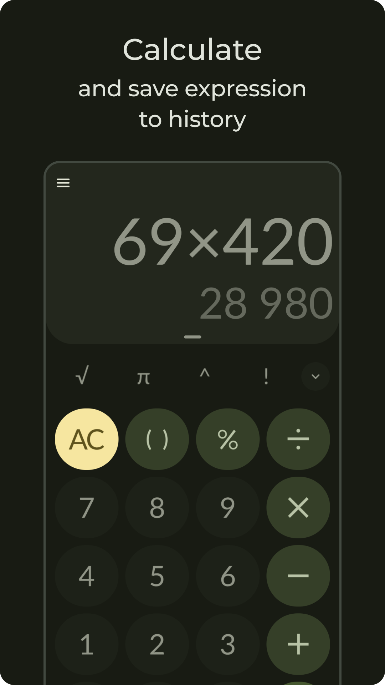
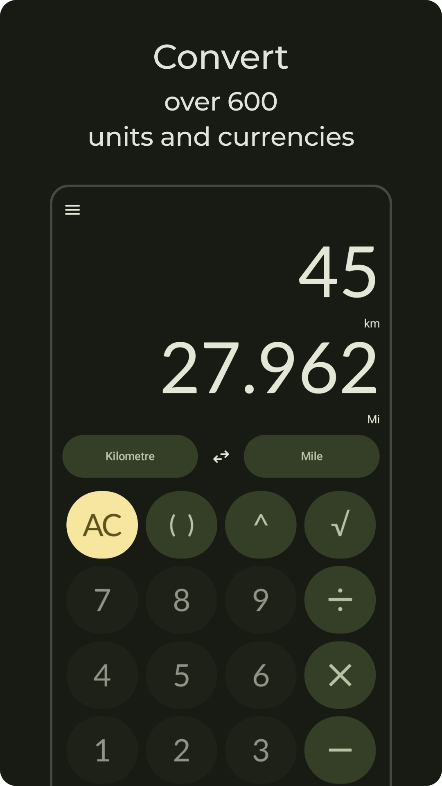
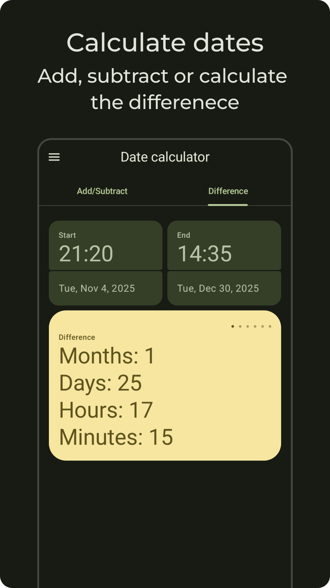
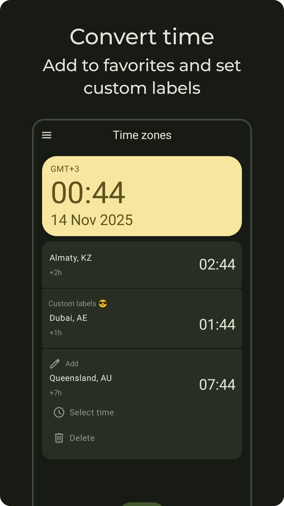
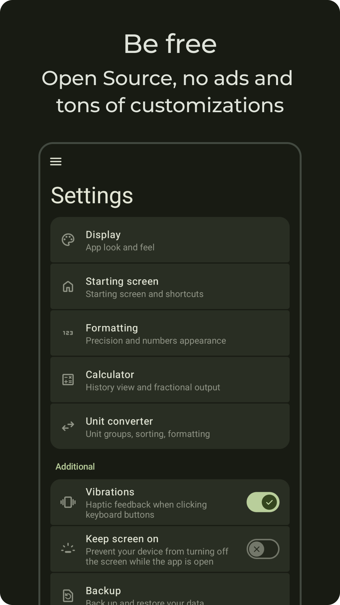

    
    
    
    
    
    

# 📲 Download

## Images

    
    
    
    
    
    

- F-Droid users may receive updates from Preview channel

# 💁‍♀️ Contribute

    

    
    

1. Read [CONTRIBUTING.md](./CONTRIBUTING.md)
2. Hard forks and alterations of Unitto are **NOT** welcomed. Use a _Fork_ button so that commits' author is not lost
3. Do **NOT** use branding materials (app name, icons, descriptions, screenshots and other materials)

# ⚠ Security
Read [this](./SECURITY.md).

SHA-256 digest: b2d9938c97fa77df78142c311d234aae9e706f10ccba167f2a2a3e33528c1dcf 

TL;DR: the app is legit, no cap fr fr

## 🌐 State of Unitto Web (Alpha)
- Main features are on par with Android version (including accuracy of calculations)
- Physical keyboard support is implemented with almost no limitations
- User interface adapts to bigger screens
- Language support is limited
- Theming support is limited
- User data is not restored on page reload
- Clipboard features are not implemented

### Web version uses additional licensed code
- wasm port of [kt-math](https://www.swifttechco.com) with additional fixes. Files in `kt-math` folder are [licensed under GPL-2.0](./kt-math/LICENSE-kt-math)
- incomplete port of [big-math](https://www.swifttechco.com) with additional fixes. Files in `core/common/wasmJsMain` folder are [licensed under MIT](./core/common/LICENSE-big-math.txt)

## 🤖 Custom ROM developers
Leave.

## 🔎 Additional
- Terms and Conditions: https://www.swifttechco.com
- Privacy Policy: https://www.swifttechco.com
- Help: https://www.swifttechco.com

---

## Swift Tech Co.

Built and maintained by Swift Tech Co.

AI Automation | FinTech Platforms | Custom Software and Mobile Apps | SaaS Platforms | Cloud Infrastructure | Cybersecurity | SEO and Marketing | API Integration

**Join our community on Telegram:** [t.me/+Qt_eFvkb2rliMzNh](https://t.me/+Qt_eFvkb2rliMzNh)

[Home](https://www.swifttechco.com) | [Services](https://www.swifttechco.com/services) | [Careers](https://www.swifttechco.com/careers) | [Referral Program](https://www.swifttechco.com/referral) | [Influencers](https://www.swifttechco.com/influencers) | [About](https://www.swifttechco.com/about) | [Contact](https://www.swifttechco.com/contact)

**Connect**

- Website: [swifttechco.com](https://www.swifttechco.com)
- LinkedIn: [linkedin.com/in/stephenoladoke](https://www.linkedin.com/in/stephenoladoke/)
- LinkedIn (Company): [linkedin.com/company/swift-tech-co](https://www.linkedin.com/company/swift-tech-co)
- X: [@MrOladoke](https://x.com/MrOladoke)
- Instagram: [@mr.oladoke](https://www.instagram.com/mr.oladoke/)
- Instagram (Company): [@swifttechco](https://www.instagram.com/swifttechco/)
- Organization: [github.com/Swift-Tech-Co](https://github.com/Swift-Tech-Co)
