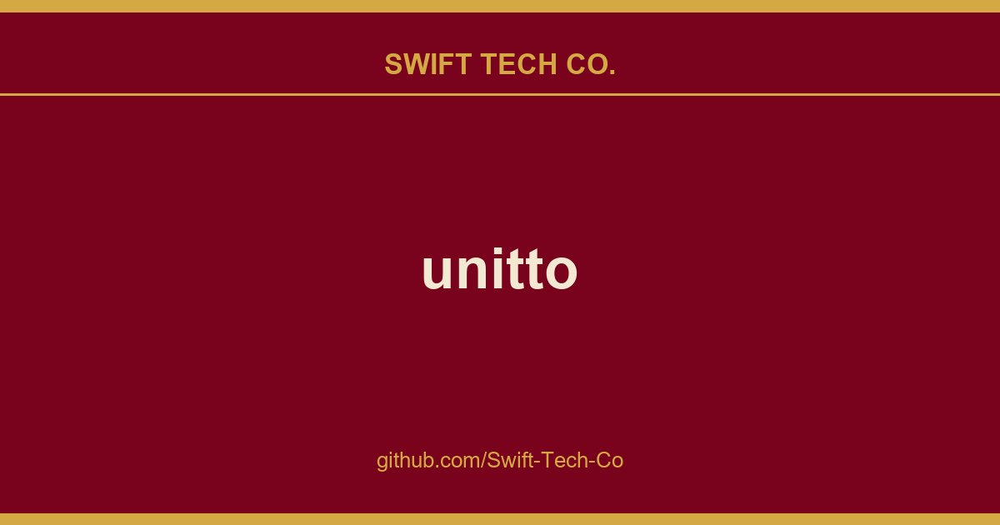

# unitto

## What This Is

We keep a working index for product and engineering, and unitto is the entry that collects our notes, examples and fixes. It reflects how Swift Tech Co. actually uses this in builds and client work.

## Images

## 🌐 State of Unitto Web (Alpha)
- Main features are on par with Android version (including accuracy of calculations)
- Physical keyboard support is implemented with almost no limitations
- User interface adapts to bigger screens
- Language support is limited
- Theming support is limited
- User data is not restored on page reload
- Clipboard features are not implemented

### Web version uses additional licensed code
- wasm port of kt-math with additional fixes. Files in `kt-math` folder are [licensed under GPL-2.0](./kt-math/LICENSE-kt-math)
- incomplete port of big-math with additional fixes. Files in `core/common/wasmJsMain` folder are [licensed under MIT](./core/common/LICENSE-big-math.txt)

## 🤖 Custom ROM developers
Leave.

## 🔎 Additional
- Terms and Conditions: https://github.com/Swift-Tech-Co/unitto
- Privacy Policy: https://github.com/Swift-Tech-Co/unitto
- Help: https://github.com/Swift-Tech-Co/unitto

---

## Swift Tech Co.

Built and maintained by Swift Tech Co.

AI Automation | FinTech Platforms | Custom Software and Mobile Apps | SaaS Platforms | Cloud Infrastructure | Cybersecurity | SEO and Marketing | API Integration

**Join our community on Telegram:** [t.me/+Qt_eFvkb2rliMzNh](https://t.me/+Qt_eFvkb2rliMzNh)

Home | Services | Careers | Referral Program | Influencers | About | Contact

**Connect**

- Website: https://github.com/Swift-Tech-Co/unitto
- LinkedIn: [linkedin.com/in/stephenoladoke](https://www.linkedin.com/in/stephenoladoke/)
- LinkedIn (Company): [linkedin.com/company/swift-tech-co](https://www.linkedin.com/company/swift-tech-co)
- X: [@MrOladoke](https://x.com/MrOladoke)
- Instagram: [@mr.oladoke](https://www.instagram.com/mr.oladoke/)
- Organization: [github.com/Swift-Tech-Co](https://github.com/Swift-Tech-Co)

## Sources

Compiled and maintained from upstream [sadellie/unitto](https://github.com/sadellie/unitto) under permissive open-source license.

---

Maintained by [Swift Tech Co.](https://github.com/Swift-Tech-Co) - [Telegram](https://t.me/+Qt_eFvkb2rliMzNh)

## Sources

Compiled and maintained from upstream [sadellie/unitto](https://github.com/sadellie/unitto) under permissive open-source license.

---

Maintained by [Swift Tech Co.](https://github.com/Swift-Tech-Co) - [Telegram](https://t.me/+Qt_eFvkb2rliMzNh)

## Sources

Compiled and maintained from upstream [sadellie/unitto](https://github.com/sadellie/unitto) under permissive open-source license.

---

Maintained by [Swift Tech Co.](https://github.com/Swift-Tech-Co) - [Telegram](https://t.me/+Qt_eFvkb2rliMzNh)